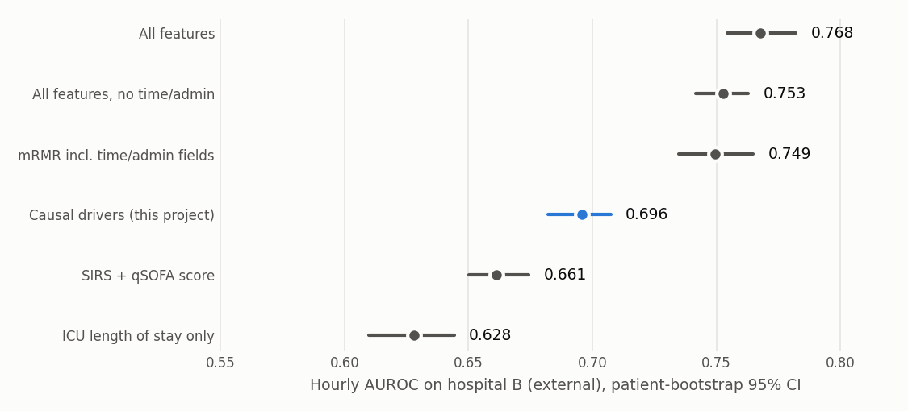
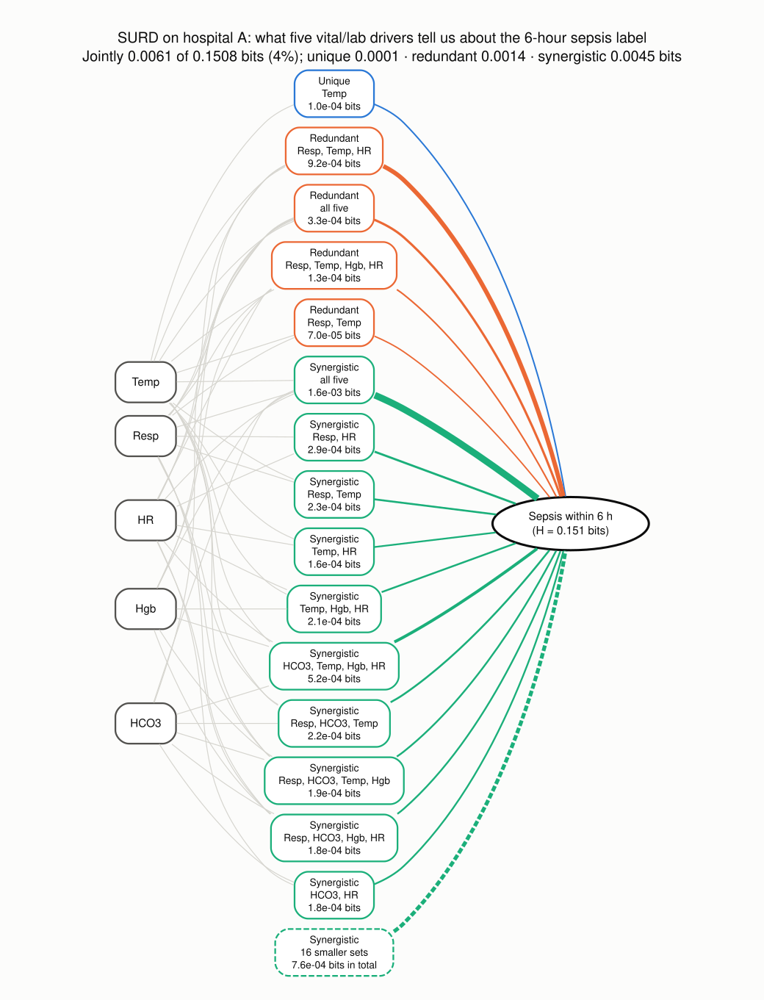

# Deep Causality: Causal Drivers and Safety Guardrails for ICU Sepsis Early Warning

[](https://github.com/KeSeaman/Deep_Causality/actions/workflows/ci.yml)
[](LICENSE)

Can a small set of causally selected physiological drivers warn of sepsis hours before onset, and can explicit guardrails stop the model from answering when the record is too sparse to trust? This project tests both on the PhysioNet 2019 challenge data, training on one hospital and testing on the other.

## Pipeline

1. **Prepare** (`scripts/prepare_data.py`): hospital A (20,336 patients) for training, hospital B (20,000) for testing; each value carried forward within the ICU stay so every hour uses only past information.
2. **Causal discovery** (Rust, `backend/`, DeepCausality): mRMR ranks drivers on hospital A only, once with ICU time and administrative fields allowed (a diagnostic) and once restricted to physiological and demographic fields (the causal-driver set: time in ICU cannot cause sepsis). A SURD decomposition then measures what the top five drivers tell us about the label, and how much of it is unique, redundant or synergistic.
3. **Detector** (`scripts/evaluate_detection.py`): LightGBM on the ten causal drivers, scoring every patient-hour.
4. **Guardrails**: the Effect Ethos rules (backend/src/ethos) block a prediction when MAP or heart rate is missing (ETHOS-001) or more than half of vitals and labs are missing (ETHOS-002). Each prediction gets an explanation: the guardrail verdict plus the five largest feature contributions (SHAP).
5. **Evaluation on hospital B** against simpler and richer baselines, with patient-bootstrap 95% confidence intervals.

## Results (hospital B, 761,995 patient-hours, 5.7% septic stays)



| Detector | Hourly AUROC (95% CI) | Hourly AUPRC | Patient AUROC |
| --- | --- | --- | --- |
| ICU length of stay only | 0.628 (0.610–0.644) | 0.048 | 0.519 |
| SIRS + qSOFA clinical score | 0.661 (0.650–0.674) | 0.028 | 0.670 |
| **Causal drivers (10 features)** | **0.696 (0.682–0.707)** | 0.039 | 0.722 |
| mRMR incl. time/admin fields | 0.749 (0.735–0.765) | 0.068 | 0.737 |
| All features, no time/admin | 0.753 (0.742–0.763) | 0.049 | 0.774 |
| All features | 0.768 (0.754–0.782) | 0.065 | 0.763 |

Hourly labels are positive from 6 hours before clinical onset, so hourly AUROC measures early warning; prevalence is 1.4% of hours.

- **The causal-driver set beats the clinical score but loses about 0.07 AUROC against using every feature.** Restricting the model to ten mRMR-selected drivers buys a shorter explanation at a measurable cost in detection.
- **ICU length of stay is a label artifact, not a driver.** Alone it reaches 0.63 hourly AUROC, because labels cluster late in long stays, but 0.52 at patient level: it says when, not who. mRMR still ranks it first when allowed, which is why the causal-driver run excludes it.
- **Alerting** (threshold set for 80% patient specificity on hospital A validation patients): the causal-driver detector flags 34% of septic patients before onset, with 90% specificity and 18% PPV on hospital B. The median lead time of 28 hours (IQR 5–71) is long enough that many early alerts are likely not sepsis-specific. The clinical score flags 56% before onset, but at 69% specificity and 10% PPV.
- **SURD on hospital A**: the top five drivers (respiratory rate, bicarbonate, temperature, haemoglobin, heart rate) jointly carry 0.0061 of the label's 0.151 bits (4%); 0.0045 bits of that is synergistic and only temperature has any unique information. A single hour's snapshot says little about imminent sepsis; what signal there is lives in combinations.



### Guardrails

| Reading of the rules | Hours allowed | Labelled-sepsis hours allowed | AUROC on allowed hours | AUROC on blocked hours |
| --- | --- | --- | --- | --- |
| Last known value counts as present | 69.9% | 83.8% | 0.708 | 0.627 |
| Only values measured this hour count | 3.6% | 6.1% | 0.711 | 0.695 |

- Under the last-known reading the guardrails do what they are for: the model is weaker on blocked hours on average (AUROC 0.627 vs 0.708 on allowed hours), at the cost of blocking 16% of labelled-sepsis hours. The rules do not single out the worst predictions; they remove a set that is worse on average. Applied to alerting they raise specificity from 0.896 to 0.908 and lower sensitivity before onset from 0.340 to 0.325.
- Read literally on hourly data (only values measured this hour), ETHOS-002 blocks 96% of hours, because labs are drawn every few hours. The rule needs the last-known interpretation to be usable.
- Example explanations, including a blocked hour: [`results/example_reports.md`](results/example_reports.md).

## Reproduce

Needs the PhysioNet 2019 data as `data/all/dataset.parquet` (see [`notes/data.md`](notes/data.md)), a Rust toolchain and Python 3.14 with `requirements.txt`.

```bash
make all       # prepare -> causal discovery (Rust) -> detector, guardrails, evaluation
make test      # Rust unit tests + Python pipeline tests
marimo edit notebooks/results_analysis.py
```

Outputs: `results/causal_discovery.json`, `results/detection_results.json`, `results/example_reports.md`, `results/detection_auroc.png`, `results/surd_decomposition.svg`.

## Implementation notes

- **DeepCausality's mRMR** does the feature selection. Its SURD function (`surd_states`, commit 6cc7f6f) is not used: it returns wrong values when the target distribution is not uniform (for a single source with p(T) = (0.7, 0.3) it reports 0.110 bits where the mutual information is 0.192), files unique information as redundant when another source carries zero specific information, fails with `ShapeMismatch` when target and source state counts differ, and panics when a source state never occurs. The same defects are reported upstream for release 0.5.4 in [deep_causality#878](https://github.com/deepcausality-rs/deep_causality/issues/878). `backend/src/causality/surd_aggregate.rs` is a port of the aggregate decomposition, checked against exact cases (XOR = pure synergy, duplicated source = pure redundancy, independent noise = no information) and against a numpy transcription of the reference code ([`scripts/surd_reference.py`](scripts/surd_reference.py)) to within 5e-13 bits.
- LightGBM trains on CPU: on the Intel Arc iGPU its OpenCL learner was about 2× slower for this workload.
- The guardrail rules are implemented and unit-tested in Rust; the evaluation applies the same rules in Python (`ethos_allowed`), because the pipeline's modelling stage is Python.

## Limitations

- One dataset, two hospitals, one label definition (the challenge's Sepsis-3-based, 6-hour-shifted label).
- "Causal drivers" here means selected under a domain prior (no time or administrative fields) and an information-theoretic criterion. Neither establishes causation: clinicians order tests when they suspect sepsis, so measurement itself carries information that is not physiology.
- The alert threshold was tuned on hospital A; specificity on hospital B came out higher (0.90 vs the 0.80 target), a reminder that operating points move between sites.
- No prospective or clinician evaluation.

Full design and rationale: [`notes/methodology.md`](notes/methodology.md).

## Project structure

```text
backend/src/causality/   mRMR (DeepCausality) and SURD decomposition
backend/src/ethos/       Effect Ethos guardrail rules
backend/src/main.rs      Causal discovery CLI -> results/causal_discovery.json
scripts/                 prepare_data.py, evaluate_detection.py, plot_results.py, plot_surd.py, surd_reference.py
tests/                   Python pipeline tests
notebooks/               eda.py, results_analysis.py (marimo)
config/default.toml      Candidates, mRMR size, SURD sources and bins
results/                 All reported numbers
```

## Acknowledgments

- [DeepCausality](https://github.com/deepcausality-rs/deep_causality) (mRMR, tensors)
- [PhysioNet/Computing in Cardiology Challenge 2019](https://physionet.org/content/challenge-2019/): Reyna et al., *Critical Care Medicine* 48(2), 2020
- Martínez-Sánchez, Arranz & Lozano-Durán, "Decomposing causality into its synergistic, unique, and redundant components", *Nature Communications* 15, 2024 (SURD)

## License

MIT
